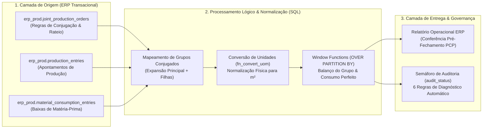

# Auditoria de Balanço de Massa ($m^2$) e Rateio de Ordens Conjugadas no Processo de Refile

## 📌 O Desafio de Negócio
Em indústrias de conversão e embalagens flexíveis, a etapa de corte/refile (*slitting*) consiste em transformar bobinas-mãe largas (ex.: $1.000\text{ mm}$) em múltiplas bobinas-filhas estreitas (ex.: $2 \times 500\text{ mm}$ ou $4 \times 250\text{ mm}$). Nesse processo, a área total ($m^2$) de matéria-prima consumida deve guardar coerência física com a área total produzida, descontada apenas a apara técnica esperada.

Na operação real, múltiplas Ordens de Produção (OPs) rodam simultaneamente na mesma máquina (**OPs Conjugadas**). Auditorias tradicionais que comparam `Produção vs. Consumo` isoladamente por OP geravam dezenas de **falsos positivos de perda ou sobra** sempre que o apontamento de consumo era concentrado na OP Principal ou quando operadores lançavam baixas manuais fora da rotina de rateio automático — distorcendo o custo unitário dos produtos e atrasando o fechamento contábil do PCP.

## 🎯 O Objetivo
* **Eliminar Falsos Positivos:** Consolidar o balanço físico de entrada e saída ($m^2$) no nível do conjunto conjugado (`master_order_id`), independentemente de como os apontamentos foram distribuídos entre as pistas.
* **Auditar a Precisão do Rateio:** Calcular o **Consumo Teórico Perfeito ($m^2$)** de cada OP filha com base no peso de participação planejado (`planned_share_pct`) e detectar desvios causados por apontamentos manuais avulsos.
* **Garantir Integridade de Virada de Período e Unidades:** Bloquear distorções causadas por OPs que cruzam a virada do mês e sinalizar itens sem fator de conversão para $m^2$ cadastrado no ERP.
* **Entregar Diagnóstico Acionável:** Substituir conferências manuais em planilhas por uma regra de classificação automática (`audit_status`) pronta para consumo operacional e BI.

## 📐 Arquitetura do Fluxo de Dados

## 🛠️ A Solução Técnica
* **Modularização via CTEs (Common Table Expressions):** A lógica foi dividida em 7 estágios semânticos (joint_orders_map $\rightarrow$ target_order_groups $\rightarrow$ order_universe $\rightarrow$ group_analytics), garantindo que, se qualquer OP filha teve atividade no período, todo o seu grupo conjugado seja avaliado integralmente.
* **Análise Multi-Granular com Window Functions:** Uso de SUM(...) OVER (PARTITION BY company_id, master_order_id) para calcular simultaneamente os totais físicos do grupo e o Consumo Perfeito de cada OP individual sem perda de linhas nem subqueries correlacionadas custosas.
* **Rastreabilidade de Exceções de Processo:** Identificação direta de apontamentos realizados fora do motor de rateio (auto_allocate_flag = 'N' OR allocation_batch_id IS NULL) e validação cruzada entre a participação cadastrada e a participação real produzida.
* **Programação Defensiva Oracle SQL:** Uso explícito de TO_DATE para preservação de índices, NULLIF para prevenção de erros de divisão por zero e NVL para tratamento seguro de apontamentos pendentes.

## 🚀 Impacto Real no Negócio
* **Prevenção de Distorções de Custo Industrial:** Evita que falhas de rateio entre pistas transfiram custo de matéria-prima indevidamente de um SKU para outro no fechamento mensal.
* **Redução drástica de Ruído Operacional:** Em validações reais de produção, conjuntos conjugados que antes disparavam alertas falsos de -15% de perda e +45% de sobra passaram a ser consolidados corretamente (revelando rendimento físico real de 96,76%) e isolando apenas o erro real de rateio.
* **Agilidade no Fechamento de PCP e Controladoria:** A equipe operacional atua diretamente por exceção filtrando a coluna audit_status, reduzindo horas de investigação manual OP a OP.
